# Still

A Signal client for the Mudita Kompakt,
designed for its E Ink screen. It talks to the real Signal service, so you keep your number
and your contacts keep using Signal as before.

Still is **unofficial**. It is not made, endorsed or supported by Signal or by Mudita.

## Read this first

- Signal has no supported way for other apps to connect. Still relies on the open-source
  libraries behind [signal-cli](https://github.com/AsamK/signal-cli) and can stop working
  whenever Signal changes its service. Expect to update it every month or two.
- This is early software, used daily by one person. Parts of it have had little or no
  testing. Don't make it your only way to reach someone who matters until you have tried it
  alongside the official app.
- Installing means sideloading an APK over USB, from the [releases page](https://github.com/kongeskog/still/releases) or built yourself.

## Screenshots

Taken on an emulator with made-up conversations, in greyscale as the Kompakt shows them.

| | | |
|---|---|---|
| 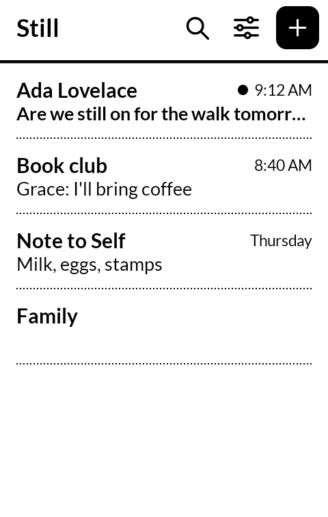 | 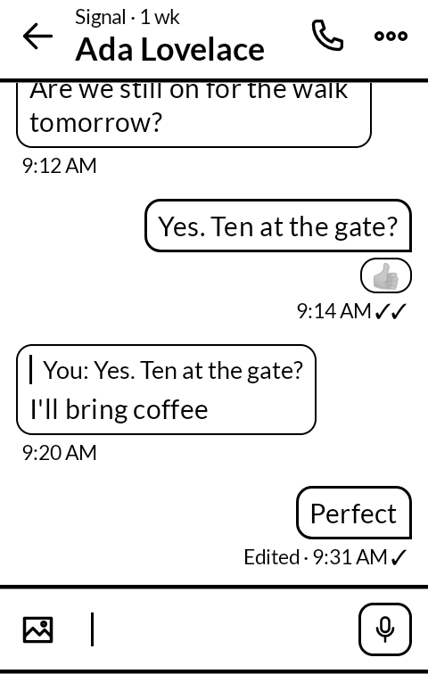 | 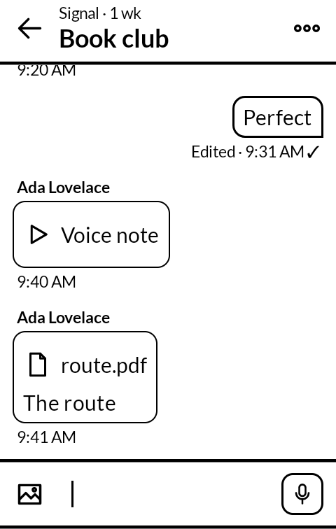 |
| 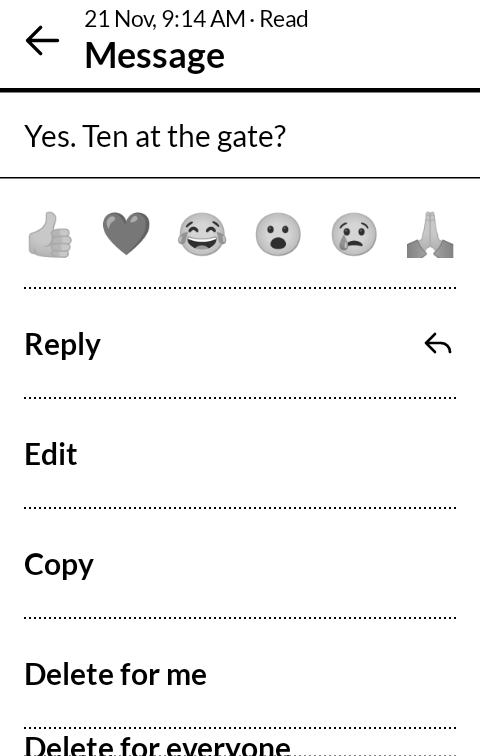 | 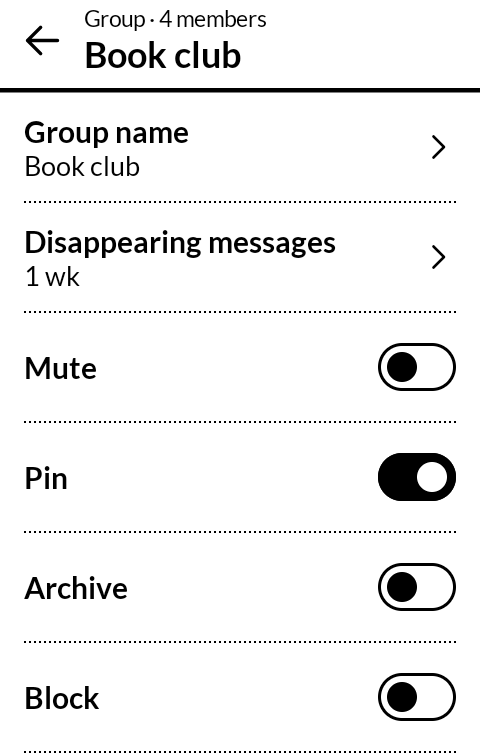 | 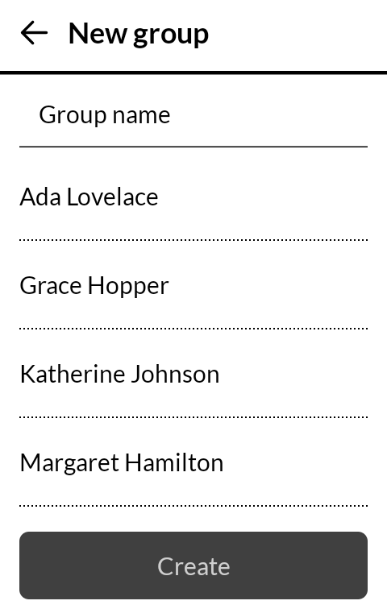 |
| 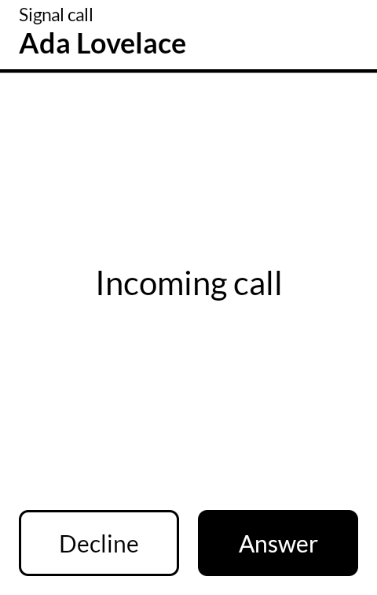 | 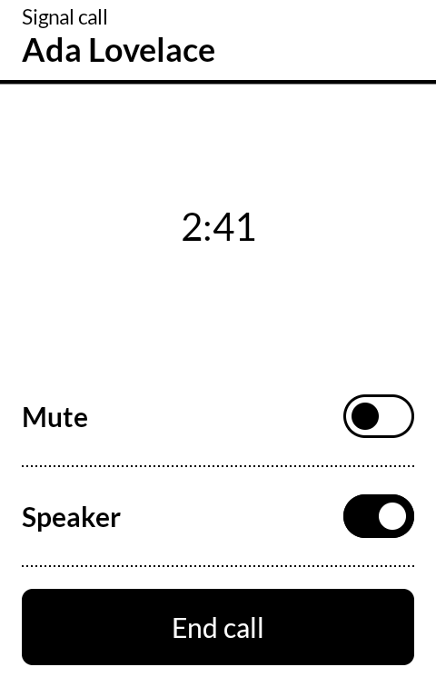 | 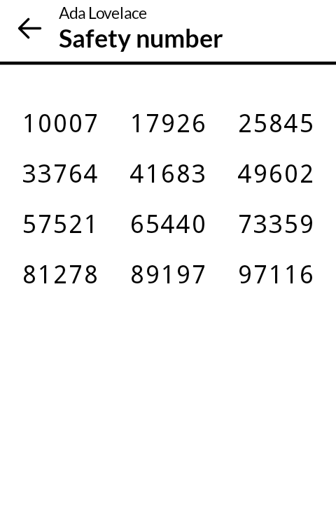 |
| 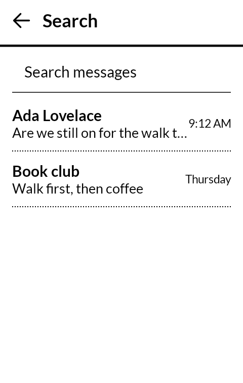 | 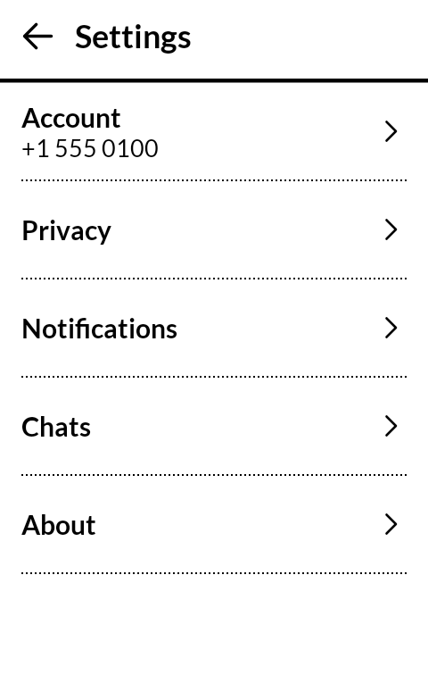 | |

## What it does

- One-to-one and group messages, with delivery and read ticks
- Replies, reactions, editing and deleting sent messages
- Disappearing messages, including changing the timer
- Photos, files and voice notes, both ways
- Voice calls, one to one (no video, no group calls)
- Groups: create, rename, add and remove members, leave
- Notifications, typing indicators, read receipts
- Mute, pin, archive, block, safety numbers, search
- Message history transferred from the official app when you link

It looks and behaves like Mudita's own Messages app: white screen, no animation, plain rows.

## What it does not do

- Video calls, group calls, stories, payments
- Media in transferred history (old photos show as the word "Photo")
- Link Signal Desktop or another device to Still
- Edit your profile name or photo
- Keep Signal's encrypted cloud copy of your contacts and settings up to date
- Run on anything but the Kompakt. It may work on other Android 12+ phones, but nothing else
  has been tried.

## Building

You need JDK 17, the Android SDK (platform 35, build-tools 34, NDK 27.1) and Gradle 8.10.

```
gradle assembleRelease
adb install -r app/build/outputs/apk/release/app-release.apk
```

`local.properties` must point at your SDK (`sdk.dir=...`). Without a `release.keystore` the
build is signed with the debug key, which is fine for personal use. If you later switch
keys, Android will refuse to install over the old build, and uninstalling deletes Still's
copy of your account.

`gradle assembleDebug -Pemulator` builds a separate `…still.debug` app that includes
`DemoActivity`: every screen with made-up data, for working on layout without an account.

## Setting up

Still starts as a **linked device**, next to the official Signal app.

1. Open Still and tap **Link to Signal**.
2. Signal links a device by scanning its QR code with the camera, so it cannot scan a code
   on its own screen. With the phone connected to a computer, run `tools/show-link-code.sh`.
   It reads the code over adb and shows it in your browser.
3. In Signal: Settings > Linked devices > Link a new device, and scan the computer screen.
   Choose **Transfer message history** if you want your old conversations.

Use it this way for a while. When you are ready to drop the official app:
Settings > Account > **Make this the main device**. This signs the official app out. No SMS
code is needed and your safety numbers do not change. The way back is to register the
official app again with your number.

## Keeping it working

Signal's servers stop accepting a client version about three months after its release.
Still shows **Update due** 60 days after its libraries were last brought up to date.

To update: in `signal-bridge/build.gradle.kts` raise the versions of
`com.github.turasa:signal-network` and `libsignal-android` to match the latest signal-cli
release, update `USER_AGENT` and `LIBRARIES_UPDATED` in `SignalEnvironment.kt`, check the
other values in that file against signal-cli's `LiveConfig.java`, rebuild and install.

## How it is put together

- `signal-bridge`: everything that speaks Signal. Storage is a Room database. `SignalClient`
  is the only class the rest of the app uses.
- `still-ui`: the screens, in Jetpack Compose with Mudita's
  [MMD](https://github.com/mudita/MMD) components.
- `app`: the activity, navigation and media handling.

Much of `signal-bridge` is a port of signal-cli's manager layer to Kotlin and Android. Calls
use Signal's [RingRTC](https://github.com/signalapp/ringrtc).

## Privacy

Still talks only to Signal's servers. It has no analytics, no crash reporting and no
accounts of its own. Messages and keys are stored unencrypted in the app's private storage
and rely on the phone's own encryption.

## Licence

GPL-3.0; see `LICENSE`. Still builds on signal-cli and Turasa's Signal libraries (GPL-3.0)
and on libsignal and RingRTC (AGPL-3.0).

"Signal" is a trademark of Signal Technology Foundation. "Mudita" and "Kompakt" are
trademarks of Mudita.
